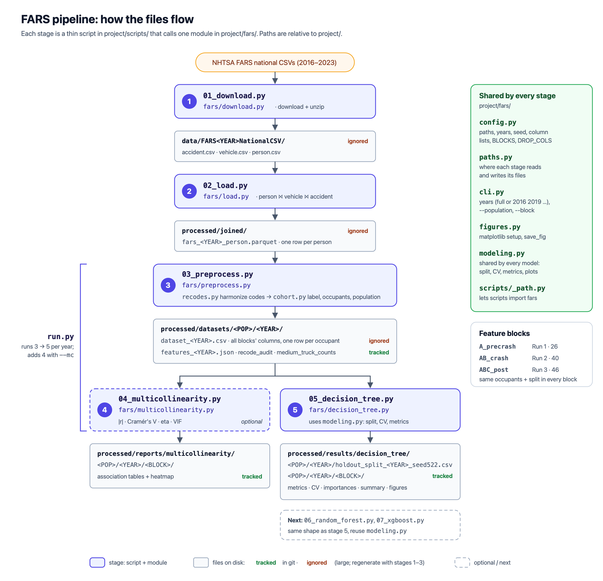

# Project Log: COSC 522 Team 13

> **Team project log**, tracked in the repo so everyone can read it: where the project stands, how to run it, what was decided and why.
> Keep it current: update **Current step** and add a dated **Log** entry at the end of each work session.

**Last updated:** 2026-11-26

**Development conventions:** see [AGENTS.md](AGENTS.md) for repository structure, modeling protocol, validation, and team handoffs.

---

## Current step

**Calibration and SHAP code for the tuned XGBoost is written (Nov 26, Moamen; branch `moamen/calibration-shap`, stacked on `iffat/rf-xgboost`). Next: run stages 8-9 on real data for one year, then all years and both populations.**

- Calibration and SHAP (Nov 26): `fars/calibration.py` (stage 8), `fars/shap_values.py` (stage 9), shared refit helper `fars/posthoc.py`, scripts `08_calibration.py` and `09_shap.py`, and `run.py --models calibration shap`. Tested end to end only on synthetic data with the real schema; **no real-data results yet**. See the Nov 26 log entry.

- RF/XGBoost (Nov 23, Iffat): `fars/random_forest.py`, `fars/xgboost_model.py`, the shared loop `fars/ensemble.py`, scripts `06_random_forest.py` and `07_xgboost.py`, and `run.py --models`. Same splits, CV folds, pipeline, tuning rule and metrics as the decision tree; each run first checks its split against the decision-tree manifest. See the Nov 23 RF/XGBoost log entry for the pilot checks and limitations.
- All-year results (Nov 24, Iffat's Windows laptop, at Tyson's request) for both models and both populations. XGBoost is best, then random forest, then the tree, in every year, block and population. See **Nov 24 RF/XGBoost results** in the Log.

Decision-tree baseline (Nov 20):

- Both populations ran all eight years × three blocks with the original tuning grid.
- Dropped predictors: `PERSONS`, `PEDS`, `NUMOCCS`, `PERNOTMVIT`. Retained `PERMVIT` and `VE_FORMS`; `VE_TOTAL` remains outside the blocks. Feature counts: 25 / 38 / 44.
- `restricted`: remove motorcycle occupants (`BODY_TYP` 80–89), then crashes with only one modeled occupant after all earlier filters, counted across vehicles using `YEAR`, `STATE`, `ST_CASE`.
- Removed the `NUMOCCS` row-exclusion rule. Preserved speed exclusions: `VSPD_LIM` 0, 98, 99.
- Verified saved outputs and cohort/split consistency for all 48 runs. See **Nov 20 rerun results** below.

**Next:** run calibration and SHAP on real data (2016 restricted first, then `full` for both populations) and record the results here; then the temporal and spatial transfer tests.

---

## Key dates

| Date | Item |
|---|---|
| Sep 15 | Proposal submitted |
| Nov 10 | Midterm presentation and report (done) |
| Weeks of Nov 16–23 | RF + XGBoost, calibration + SHAP, transfer tests |
| Nov 23 – Dec 4 | Final presentation and report |
| **Dec 4** | **Final due** |

---

## Project summary

- **Question:** within a crash that killed at least one person, what predicts whether a particular occupant survived?
- **Track 2 (Novel Application):** standard ML methods applied to a new question.
- **Data:** FARS national files, 2016–2023. Person ⋈ Vehicle (crash + vehicle) ⋈ Accident (crash), one row per occupant.
- **Label:** fatal = K (died within 30 days). Survived = A/B/C/O. Unknown severity and deaths before the crash are removed.
- **Population (midterm):** 641,407 drivers and passengers → 628,723 with a known outcome → **587,960 occupants / 269,688 crashes** after dropping unknowns in age, model year, number of occupants and speed limit (speed limit 0 is also dropped). 40.4% fatal; test-set fatal share 0.397–0.414.
- **Motivating stat:** 49.7% of 113,377 vehicles with 2+ modeled occupants had one occupant die and another survive.
- **Team:** Habibatur R Iffat, Robert Tyson Beach, Ziad Abdelati, Moamen Ahmed (GitHub `memara51`).

### Feature blocks (46 features, nested)

| Block | Count | Code name (`BLOCKS`) | Contents |
|---|---|---|---|
| A, pre-crash | 26 | `A_precrash` | age, sex, person type, seat, restraint; body type, model year, # occupants, towing, license; speed limit, alignment, profile, surface, trafficway, lanes, traffic control ×2; hour, weekday, month; land use, functional system, light, weather, junction |
| B, crash configuration | 14 | `AB_crash` | impact point, pre-crash movement, critical event, stability, pre-impact location; speeding; driver drinking ×2; first harmful event; manner of collision; relation to road; # vehicles, motorists, non-motorists |
| C, consequence | 6 | `ABC_post` | airbag, ejection, extrication, rollover, damage, fire |

Run 1 = A, Run 2 = A+B, Run 3 = A+B+C, all on the same occupants. `PERSONS` and `PEDS` were dropped as near-duplicates of `PERMVIT` / `PERNOTMVIT` (99.5% identical).

### Model setup (decision tree baseline)

- One tree per year and run: 8 × 3 = 24 trees.
- Imputation (median + missing indicators for numeric, a constant for categorical) and one-hot encoding are fitted inside an sklearn pipeline on the training data only.
- 80/20 `GroupShuffleSplit` by crash, seed 522.
- 5-fold `StratifiedGroupKFold` CV, grouped by crash. Grid: max_depth {4, 8, None} × min_samples_leaf {20, 100} × ccp_alpha {0, 0.001}. Selection is by CV average precision.
- The test set is scored once. Reference models: majority dummy, an unrestricted tree, and a depth-4 tree.
- Metrics: ROC-AUC, average precision (no-skill = fatal share), balanced accuracy, fatal recall.
- No `class_weight` (removed on purpose; see decisions).

---

## Midterm results (full population, decision tree)

**Test ROC-AUC**

| Run | 2016 | 2017 | 2018 | 2019 | 2020 | 2021 | 2022 | 2023 | Mean |
|---|---|---|---|---|---|---|---|---|---|
| 1: A | .833 | .826 | .827 | .828 | .828 | .830 | .833 | .834 | **.830** |
| 2: A+B | .888 | .886 | .885 | .888 | .890 | .888 | .893 | .896 | **.889** |
| 3: A+B+C | .913 | .913 | .914 | .916 | .920 | .919 | .916 | .923 | **.917** |

**Means over years**

| Run | ROC-AUC | Avg. precision | Bal. acc. | Fatal recall |
|---|---|---|---|---|
| 1 | .830 | .793 | .745 | .626 |
| 2 | .889 | .867 | .789 | .698 |
| 3 | .917 | .894 | .821 | .759 |
| Dummy | .500 | .402 | .500 | .000 |

- Block B adds about 0.059 AUC and Block C a further 0.028, so about two-thirds of the gain comes from B.
- Tuning matters. Run 1 AP: unrestricted tree 0.543, depth-4 tree 0.739, tuned tree 0.793.
- **Importance:** restraint use is #1 in every run (50.8% / 36.9% / 24.9%). In Run 1 it is followed by # occupants in the vehicle (20.8%) and age (9.4%). In Run 3, extrication (18.1%) and ejection (12.0%) are high. Run 3 rankings are unstable: in 2016 and 2017, ejection ranks first.

**Caveats (reported as preliminary negative results):**
1. **Occupant-count artifact.** Every FARS crash has at least one death, so fewer people involved means a higher chance that a given person was the one who died. Fatal share by modeled occupants in the crash (2016 / 2023): 1 → .678/.642, 2 → .469/.470, 3–4 → .332/.333, 5+ → .200/.207.
2. **Motorcycle riders are mixed into restraint = "none used"** (by FARS from 2019, and by our recode for 2016–2018). That single category carries 46–50% of Run 1 importance, so restraint use is probably overstated.

Both caveats motivate the restricted population (the current step).

---

## Nov 20 rerun results

User ran full and restricted on this machine; outputs reviewed Nov 20. Unweighted means across eight years for the tuned tree selected by CV average precision:

| Population | Block | ROC-AUC | Average precision | Balanced accuracy | Fatal recall |
|---|---|---|---|---|---|
| full | A_precrash | 0.820 | 0.768 | 0.736 | 0.615 |
| full | AB_crash | 0.883 | 0.856 | 0.783 | 0.696 |
| full | ABC_post | 0.913 | 0.886 | 0.820 | 0.768 |
| restricted | A_precrash | 0.762 | 0.593 | 0.655 | 0.425 |
| restricted | AB_crash | 0.802 | 0.642 | 0.687 | 0.502 |
| restricted | ABC_post | 0.854 | 0.717 | 0.746 | 0.617 |

- **Full:** 590,800 occupants / 271,317 crashes. **Restricted:** 426,864 occupants / 135,777 crashes. These supersede intermediate preprocessing totals below; removal of the NUMOCCS row filter changed cohort eligibility.
- Mean holdout fatal prevalence: full **40.2%**, restricted **31.3%**; also the no-skill AP references. Interpret raw AP alongside prevalence.
- Block A mean training impurity importance: restraint use **54.4% → 35.1%**, age **11.3% → 26.0%** (full → restricted). Restraint remains the highest field by mean Block A importance. These are associations, not causal effects.
- Restricted Block C: extrication (**27.3%**) and ejection (**22.9%**) lead mean importance. PERMVIT remains substantial in restricted Block B (**16.7%**).
- Full versus restricted compares different target populations and separately generated crash-grouped splits; it does not isolate a causal motorcycle effect. Midterm comparisons also include changed predictors and removal of the NUMOCCS row filter.
- Validation: all 48 block runs have baseline CV, 12-setting grid tables, holdout metrics, complexity, importance, summaries, and four figures. Feature metadata has 25/38/44 columns; dropped columns are absent; speed exclusions hold; restricted has no motorcycle occupants or singleton crashes; manifests match dataset identities/labels; no crash crosses train/test. Models were not rerun during review.

---

## Plan / status

| Task | Timeline | Status |
|---|---|---|
| Feature review and three blocks | Sep–Oct | Done |
| 2016 pipeline and decision tree pilot | Sep–Oct | Done |
| Harmonize codes, 2016–2023 | Early Nov | Done |
| Decision tree baseline, 8 years × 3 runs | Early Nov | Done |
| Logistic regression baseline | – | Dropped |
| Midterm presentation and report | Nov 10 | Done |
| Refactor scripts into `fars/` package + numbered scripts | Nov 18 | Done, verified identical (branch `refactor-scripts`, not committed) |
| **Exclusions and variable drops; re-run baseline** | Week of Nov 9 | **Done Nov 20; results reviewed** |
| Random forest (benchmark) and XGBoost (primary) | Weeks of Nov 16–23 | **Done Nov 24 (both models, both populations, all eight years)** |
| Calibration and SHAP | Weeks of Nov 16–23 | **Code written Nov 26 (Moamen); real-data runs pending** |
| Transfer, time: train 2016–2020 → test 2021–2023 | Weeks of Nov 16–23 | Planned |
| Transfer, space: train on one state group → test on a disjoint group | Weeks of Nov 16–23 | Planned |
| Final presentation and report | Nov 23 – Dec 4 | Planned |

**Committed for the final report (from the proposal):** confusion matrix, macro-F1, calibration, SHAP on the best model, and both the full and restricted populations.

---

## Decisions and rules (don't undo without discussing)

- **Decision tree replaced logistic regression** as the baseline. It is readable, finds interactions on its own, and shows which variables to drop.
- **Three blocks, not two.** How the crash happened is neither fixed before it nor a consequence of it.
- **No `class_weight`.** The data is about 40% fatal. Class weighting only traded recall against precision and made the grid search flip.
- **All results are run on this machine** (`cosc522` conda env). Deep trees and CV folds differ slightly across machines (the teammate is on Windows), so results from other machines can't be mixed in.
- **Code harmonization (`RECODES` in `fars/recodes.py`, toggled by `APPLY_RECODES` in `fars/preprocess.py`):** 2016 restraint/airbag N/A codes → 2017+ codes; 2016–18 helmet codes → "none used"; 2016–17 pickup → Light Pickup; rollover subtypes → a single rollover code; 2022 rollover N/A → no rollover; 2022 damage "extent unknown" → not reported; driver drinking rebuilt from `DR_DRINK` for 2021+. **Judgment calls:** `VTRAFWAY` 7→9 and `REST_USE` 6→97. Every rule is logged in a per-year audit file. The table is in `fars/recodes.py`.
- **Known reporting shift:** unknown or not-reported `VTRAFCON` goes from 3.0% (2016–20) to 16.6% (2021–23). This matters for the temporal transfer test.
- **`notebooks/decision_tree_v2.ipynb`:** code cells 1–11 (through `base_df`) are Tyson's and stay untouched. The classmate's code starts at code cell 12.
- All `.py` files use **CRLF** line endings (the team's convention), so preserve them when editing.
- Results are associations within fatal crashes, **not causal effects**.

---

## Repo map

```
project/
  fars/                  shared code (importable package); one module per stage + shared helpers
    config.py            paths, years, seed, column lists, feature BLOCKS, DROP_COLS, unknown codes
    paths.py             where every stage reads/writes (see its docstring for the full tree)
    recodes.py           RECODES harmonization table + DRUNK_DR rebuild
    cohort.py            label, occupant filter, unknown-code exclusions, population (full / restricted)
    modeling.py          model-agnostic: crash split, grouped CV, pipeline, metrics, plots, importances
    download.py, load.py, preprocess.py, multicollinearity.py, decision_tree.py   the stages
    random_forest.py, xgboost_model.py   stages 6-7: estimator + tuning grid only
    ensemble.py          run loop shared by RF and XGBoost (split check, CV, grid, holdout, outputs)
    figures.py, cli.py   matplotlib setup + save_fig; shared command-line arguments
  scripts/               thin, numbered entry points (each calls fars.<stage>.main)
    01_download.py  02_load.py  03_preprocess.py  04_multicollinearity.py  05_decision_tree.py
    06_random_forest.py  07_xgboost.py  run.py
  notebooks/             earlier notebooks (not used anymore; paths inside them may be stale)
  processed/             outputs; results + reports tracked, large data ignored (see How to run)
  data/                  raw FARS CSVs (gitignored)
  fars_variable_lists.xlsx, data_dictionary.pdf
misc/                    proposal, midterm slides/report (misc/midterm update/), talking points
pyproject.toml           black line length (100)
PROJECT_LOG.md           this log
pipeline_flow.png        flow chart of scripts → modules → files (shown in How to run)
pipeline_flow.svg        editable source of the flow chart
```

**Run:** see **How to run** below.

**Git:** work happens on a personal branch → PR into `main` (PR #2 merged on Nov 9 with the 2016–2023 results).

---

## Refactor (Nov 18)

**Why.** The five scripts in `project/scripts/` had grown hard to read:
- The same setup was copied between files: path lookup, years, the year parser and output-folder helpers. The tiers were defined twice and could drift apart.
- `preprocessing.py` (708 lines) mixed configuration, the recode table, cohort cleaning and the multicollinearity report.
- `decision_tree.py` (763 lines) mixed model-agnostic code (split, CV, metrics, plots) with tree-specific code. Random forest and XGBoost would have had to copy it.
- Cleaned datasets were stored under `decision_tree/`, and nothing separated the full and restricted populations.
- The code said `base` / `base_impact` / `base_impact_post` while the report says Blocks A/B/C.
- Jupyter-mode branches ran through all the scripts.

**What changed.**

| Before | After |
|---|---|
| 5 scripts with the logic inside them | `project/fars/` package (shared logic) + 6 thin numbered scripts in `project/scripts/` |
| Settings copied across files | Defined once in `fars/config.py` (paths, years, seed, columns, `BLOCKS`, `DROP_COLS`, unknown codes) |
| `RECODES` ≈170 lines inside `preprocessing.py` | `fars/recodes.py`, one rule per 2–3 lines |
| Split/CV/metrics/plots inside `decision_tree.py` | `fars/modeling.py`, shared by every model; `fars/decision_tree.py` keeps only the grid, baselines, diagram and complexity |
| Tiers `base` / `base_impact` / `base_impact_post` | Blocks `A_precrash` / `AB_crash` / `ABC_post` |
| Three dataset CSVs per year (one per tier) | One `dataset_<YEAR>.csv` per year; the blocks are column subsets, so every block shares the same occupants and split by construction |
| Multicollinearity rerun on every pipeline run | Report only, opt-in: `run.py full --mc` (or step 04 alone) |
| No population dimension | `--population` flows into all output paths (only `full` exists so far) |
| Holdout split saved 3× per year | Saved once per year |
| `processed/preprocessed/`, `processed/decision_tree/<YEAR>/...` | `processed/joined/`, `datasets/`, `reports/`, `results/` (see How to run) |
| Notebooks in `project/` | `project/notebooks/` (not used anymore; paths inside them may be stale) |
| Jupyter mode, `show()`, `INTERACTIVE` | Removed; scripts run from the terminal only |
| Years one at a time | Required: `full` (every year) or individual years separated by spaces (`run.py 2016 2019`); a bad year gives a clean error |

**Verification.** All 8 years were re-run with the new code and compared with the midterm outputs, with exact equality required. Every table was identical (0 differences): the recode audit, the full dataset, the holdout split, baseline CV, grid-search CV (timings excluded), holdout metrics, tree complexity, feature importances, and all three multicollinearity tables per block. The figures and summaries were regenerated from the same numbers. A full run takes about 2 minutes per year with every step, so about 15 minutes for all 8.

**Housekeeping.**
- All `.py` files keep CRLF line endings.
- `pyproject.toml` sets black's line length to 100. The column lists and `RECODES` are wrapped in `# fmt: off`.
- `__pycache__/` is gitignored.
- **Git tracking:** results and reports are tracked so the team sees them (the midterm outputs had been force-added in PR #2). The joined parquet files, the dataset CSVs and old stray CSVs are ignored. The new result files replace the old ones in git.
- **Status:** on branch `refactor-scripts`, staged, **not committed yet**. Before merging, tell the teammate who wrote the original scripts that the layout changed.
- **Leftover on disk:** `project/processed/decision_tree/` holds only the old untracked dataset CSVs. It is ignored and safe to delete.

**Adding the next pieces:**
- **Restricted population:** both exclusions are implemented (Nov 20): remove motorcycle occupants, then crashes with only one remaining modeled occupant.
- **A new model** (random forest, XGBoost): copy the shape of `fars/decision_tree.py` (an estimator, a grid and `run_block`), reuse `fars/modeling.py`, add a `0N_<model>.py` script, and call the new module from `run.py` after the decision tree.

---

## How to run



*`pipeline_flow.png` (repo root, next to this log) shows how the scripts, the `fars/` modules and the files on disk connect. It opens as an image on macOS and Windows. Its editable source is `pipeline_flow.svg`. When the pipeline changes, edit the SVG as text, then regenerate the PNG (or ask Claude to). On a Mac, the built-in tools can render it: `qlmanage -t -s 2280` on a square-padded copy, then `sips --cropToHeightWidth 2200 2280`.*

You can run every script from any directory, because paths are anchored to `project/`. The commands below assume the repo root. **Every script needs the years**, given one of two ways:
- `full` runs every year, 2016–2023.
- Individual years go separated by spaces, e.g. `2016 2019 2023`.

Ranges like `2016-2023`, mixing `full` with years, and running with no year are all rejected with a clear message. Note that `full` here means all years; the study population is chosen separately with `--population`. Run everything that gets reported on **this machine** (see decisions).

```bash
conda activate cosc522          # system python3 has no pandas/pyarrow

# Once: raw data and the joined per-year tables
python project/scripts/01_download.py full   # → project/data/ (skips years already present)
python project/scripts/02_load.py full       # → processed/joined/fars_<YEAR>_person.parquet

# Per-year pipeline: always preprocess, then decision trees (all three blocks)
python project/scripts/run.py full                       # every year
python project/scripts/run.py 2016 2023                  # only these years
python project/scripts/run.py full --mc                  # + the multicollinearity report
```

**The multicollinearity report only reports.** It writes association tables, a VIF table and a heatmap per block, and flags pairs ≥ 0.50 (moderate) and ≥ 0.80 (high). It never drops or changes anything. Columns are removed only by editing `DROP_COLS` in `fars/config.py` after the team reviews the report (that is how `PERSONS` and `PEDS` were dropped). That is why `run.py` leaves it off by default. Run it when the features or the cohort change.

**Run one stage on its own:**

```bash
python project/scripts/03_preprocess.py 2019                        # recodes + cohort → dataset
python project/scripts/04_multicollinearity.py 2019                 # optional report, per block
python project/scripts/05_decision_tree.py 2019                     # all three blocks
python project/scripts/05_decision_tree.py 2019 --block A_precrash  # one block: A_precrash | AB_crash | ABC_post
python project/scripts/06_random_forest.py 2019 --population restricted   # all three blocks
python project/scripts/07_xgboost.py 2019 --population restricted         # all three blocks
python project/scripts/run.py 2019 --models decision_tree random_forest xgboost
python project/scripts/08_calibration.py 2019 --population restricted     # needs XGBoost results
python project/scripts/09_shap.py 2019 --population restricted            # needs XGBoost results
```

**Random forest and XGBoost** need the decision-tree split manifest for the same year and population (`results/decision_tree/<POP>/<YEAR>/holdout_split_<YEAR>_seed522.csv`), and they stop if their own split differs from it. `run.py` runs only the decision tree unless `--models` is given. Grids (`PARAM_GRID`) are in `fars/random_forest.py` and `fars/xgboost_model.py`. Pilot timings on a 2-core machine with `N_JOBS = 2`, per year and population, all three blocks: random forest about 22 minutes, XGBoost about 6 minutes. At that speed, all eight years for both populations take roughly 6 hours (RF) and 1.6 hours (XGBoost); a larger `N_JOBS` on a machine with more cores shortens this without changing results.

Stages 3–5 and `run.py` also take `--population full` or `--population restricted`. `restricted` excludes motorcycle occupants (`BODY_TYP` 80–89), then crashes with only one remaining modeled occupant after all cohort filters. `--block` works with `05_decision_tree.py` and `run.py`. Every script prints its options with `--help`. Stages 4 and 5 read the dataset that stage 3 saved, so re-run stage 3 whenever the cohort, the recodes or the features change.

**Switches in the code:**
- The feature blocks, `DROP_COLS`, `UNKNOWN_CODES` and the column lists are in `fars/config.py`.
- The recode rules are in `fars/recodes.py`. `APPLY_RECODES` (`fars/preprocess.py`, default `True`) set to `False` reproduces the original 2016 results from before harmonization. It only works for 2016–2020, because 2021+ needs the `DRUNK_DR` rebuild that comes with the recodes.
- The tree grid and baselines (`PARAM_GRID`, `BASELINES`) are in `fars/decision_tree.py`. The split and CV settings (`TEST_SIZE`, `N_FOLDS`, `SCORING`) are in `fars/modeling.py`.

**Where the outputs go** (under `project/processed/`):
- `joined/`: `fars_<YEAR>_person.parquet`, `load_summary.csv` (one row per year; re-loading some years updates only their rows)
- `datasets/<POP>/<YEAR>/`: `dataset_<YEAR>.csv` (all blocks' columns), `features_<YEAR>.json`, `recode_audit_<YEAR>.csv`, `population_audit_<YEAR>.csv`, `medium_truck_counts_<YEAR>.csv`
- `reports/multicollinearity/<POP>/<YEAR>/<BLOCK>/`: association tables and a heatmap
- `results/decision_tree/<POP>/<YEAR>/`: `holdout_split_<YEAR>_seed522.csv`, plus a folder per `<BLOCK>/` holding `baseline_cv_*`, `grid_search_cv_*`, `holdout_metrics_*`, `tree_complexity_*`, `feature_importances_*`, `summary_*.md`, `figures/*.png`
- `results/random_forest/` and `results/xgboost/`, same layout: `holdout_split_*` (identical to the decision tree's), `environment_<YEAR>.json`, and per `<BLOCK>/`: `baseline_cv_*` (default settings), `grid_search_cv_*`, `best_params_*.json`, `holdout_metrics_*` (majority dummy, default settings, tuned), `feature_importances_*`, `summary_*.md`, `figures/*.png`
- `results/xgboost_calibration/<POP>/`: `calibration_all_years.csv`, `calibration_means.csv`; per `<YEAR>/`: `environment_*`, `refit_check_*`, and per `<BLOCK>/`: `calibration_cv_*`, `calibration_holdout_*`, `reliability_bins_*`, `selected_method_*.json`, `summary_*.md`, `figures/reliability_*.png`
- `results/xgboost_shap/<POP>/`: `shap_all_years.csv`, `shap_means.csv`, `figures/shap_by_year_<BLOCK>.png`; per `<YEAR>/`: `environment_*`, `refit_check_*`, and per `<BLOCK>/`: `shap_by_field_*`, `shap_by_column_*`, `shap_by_category_*`, `summary_*.md`, `figures/shap_{importance,beeswarm,dependence,categories}_*.png`
- `decision_tree/`: leftover from the old layout (untracked dataset CSVs only). Safe to delete.

**Tracked in git:** everything under `results/` and `reports/`, plus `features_*.json`, `recode_audit_*.csv`, `population_audit_*.csv`, `medium_truck_counts_*.csv` and `load_summary.csv`. **Ignored:** `joined/*.parquet` and `datasets/**/dataset_*.csv` (regenerate them with steps 02–03).

**Typical workflow after a code change:** `python project/scripts/run.py full`, then check `results/decision_tree/<POP>/<YEAR>/<BLOCK>/holdout_metrics_*.csv` and `summary_*.md`.

---

## Motorcycle-related variables in the current blocks

Dictionary review (2026-11-20): of the motorcycle-related variables reviewed, **`BODY_TYP`, `REST_USE`, and `PER_TYP`** are included in `PRECRASH_COLS` in `project/fars/config.py`. All three therefore appear in every nested run: `A_precrash`, `AB_crash`, and `ABC_post`. Keep these in view when deciding the motorcycle exclusions and interpreting restraint importance.

- `BODY_TYP`: the direct vehicle classification; the dictionary's NCSA motorcycle group is codes **80–89**, including mopeds, scooters, and autocycles. ATVs (90) and snowmobiles (91) are outside that group.
- `REST_USE`: includes helmet-related codes in 2016–2018; helmet use moved to `HELM_USE` in 2019. Our current harmonization merges the earlier helmet codes into 20 (none used/not applicable), so the modeled value alone cannot identify all motorcycle riders.
- `PER_TYP`: identifies driver/passenger role, not motorcycle status by itself; the current cohort keeps codes 1 and 2.

The other reviewed fields, including `VPICBODYCLASS`, `HELM_USE`, `HELM_MIS`, and auxiliary motorcycle/helmet classifications, are **not in the current feature blocks**. Update: the motorcycle row exclusion was implemented later on Nov 20; all three variables remain features for retained occupants. Source: `project/data_dictionary.pdf`, printed pp. 139, 298–299, 303–307, C-29–C-30.

---

## Open questions

- [x] Count-predictor decisions: drop `NUMOCCS` (also remove its row filter) and `PERNOTMVIT`; retain `PERMVIT` and `VE_FORMS`. `VE_TOTAL` is acceptable to retain but is not currently in the blocks; no addition made.
- [x] Preserve existing speed exclusions for this test: `VSPD_LIM` 0, 98, 99. Code 0 is substantive, not 0 mph; revisiting its representation is deferred.
- [x] Motorcycle exclusion: use `BODY_TYP` 80–89, including mopeds/scooters/autocycles; retain ATVs (90) and snowmobiles (91).
- [x] Exclude crashes with only one modeled occupant after all earlier cohort filters, including motorcycle removal. Count across all vehicles, not all persons (pedestrians are outside the modeled cohort).
- [ ] Who on the team owns the transfer tests? (RF/XGBoost implementation: Iffat, Nov 23. Calibration and SHAP: Moamen, Nov 26.)
- [x] Preserve the current decision-tree grid for this rerun (Nov 20 decision).
- [ ] Transfer by state: how should the state groups be chosen (random? region?) and how many?

---

## Log

### 2026-11-26 (calibration and SHAP, Moamen)
- Implemented stages 8-9 on branch `moamen/calibration-shap` (based on `iffat/rf-xgboost`, PR not yet merged). New files: `fars/posthoc.py` (shared refit and checks), `fars/calibration.py`, `fars/shap_values.py`, `scripts/08_calibration.py`, `scripts/09_shap.py`. Changed: `scripts/run.py` (`--models` accepts `calibration` and `shap`; default unchanged), `fars/__init__.py` (docstring). No existing module, cohort, split, grid or result changed. New Python files use CRLF and pass Black at 100.
- **Refit:** fitted models are not saved, so both stages refit the tuned XGBoost from `best_params_<BLOCK>_<YEAR>.json` on the same training rows, after checking the split against both the decision-tree and XGBoost manifests. The refit is scored on the holdout and compared with the saved tuned row; `refit_check_<YEAR>.csv` records saved vs refit AP/ROC-AUC, whether the confusion counts match, and `reproduced`. A mismatch is reported, not fatal, because XGBoost subsampling differed across operating systems in the Nov 23 pilots.
- **Calibration protocol** (nothing learned from the holdout): out-of-fold training probabilities from the saved five grouped folds; Platt (sigmoid on logit p) and isotonic maps fitted on those OOF probabilities and applied to the refit model (as `CalibratedClassifierCV(ensemble=False)`); methods compared by cross-fitting the maps over the OOF folds. Pre-declared rule: lowest mean CV Brier, and a more complex method (uncalibrated < sigmoid < isotonic) must win by more than 1e-4. Holdout reports Brier (and no-skill Brier), log loss, ECE and max bin error (10 equal-count bins), calibration intercept/slope, mean predicted vs observed fatal share, plus the shared `modeling.evaluate` metrics for every method. Prediction rule unchanged (fatal if p > 0.5).
- **SHAP protocol:** exact TreeSHAP from XGBoost itself (`pred_contribs=True`, same values as `shap.TreeExplainer`; the `shap` package is not needed, so the `cosc522` env needs nothing new). All holdout occupants explained, on the log-odds scale; additivity (bias + SHAP = log-odds) asserted to 1e-3. One-hot and missing-indicator columns are summed to the original field (valid because SHAP is additive). Outputs per field, per encoded column, and per raw category value, plus the Spearman correlation between the SHAP and gain field rankings.
- Both stages refresh across-year tables after each run (`calibration_means.csv`, `shap_means.csv`, and a SHAP-by-year heatmap per block) from whatever years exist on disk.
- **Checks actually performed (synthetic data only, Linux, Python 3.13, scikit-learn 1.9.1, xgboost 3.4.1):** the FARS download host is not reachable from the environment used, so a synthetic dataset was built with the real 2016/2017 restricted and 2016 full feature lists, crash/vehicle/person keys and missing values. Both stages ran for all three blocks and two years without warnings; all output files and figures exist; SHAP additivity held to about 5e-6; SHAP ranked the fields that the synthetic label was built from at the top (AGE, EJECTION, REST_USE, EXTRICAT, MOD_YEAR, VSPD_LIM, HARM_EV), which checks the field mapping; after running `07_xgboost.py` on the synthetic data, the refit reproduced its saved holdout metrics exactly (`reproduced=True`); a `--block` rerun kept the other blocks' rows in `refit_check`; on the overfit synthetic model the CV rule chose sigmoid and the holdout slope moved from about 0.5 to about 0.93. Synthetic outputs were not committed.
- Limitations: no real-data results yet. OOF probabilities come from models trained on 80% of the training rows, so the maps are fitted to slightly weaker models than the final refit (the usual `ensemble=False` caveat). SHAP and calibration describe one year's holdout, not other years or states (transfer tests); related fields can share SHAP credit; nothing is causal. Iffat's Nov 23 Python files (`ensemble.py`, `random_forest.py`, `xgboost_model.py`, `06_random_forest.py`, `07_xgboost.py`) are LF, not CRLF as noted; left unchanged.
- Run time on synthetic data (about 10,000 occupants per year, 2 cores): about 16 s per year for calibration and 13 s for SHAP, all three blocks. Real data is 4-6 times larger per year; calibration does 6 XGBoost fits per block (5 OOF + refit), SHAP 1.
- Next: on the machine whose XGBoost results are committed (Iffat's laptop, to reproduce exactly), run `08_calibration.py 2016 --population restricted` and `09_shap.py 2016 --population restricted`, confirm `refit_check_2016.csv` shows `reproduced=True`, then `full` for both populations; record results here.

### 2026-11-24 (RF/XGBoost results, Iffat)
- Ran all eight years of `07_xgboost.py` and `06_random_forest.py` for both populations on Iffat's Windows laptop (Python 3.12, scikit-learn 1.9.1, xgboost 3.4.1, conda env `fars`), as agreed with Tyson. The decision-tree results remain those from the Nov 20 run on Tyson's machine. Before modeling, the rebuilt datasets reproduced the committed load summary, population audits and feature metadata for every year and both populations (no tracked dataset file changed), and every RF/XGBoost run confirmed its split against the committed decision-tree manifest.
- `config.N_JOBS` was raised to 8 locally to use the laptop's cores; this changes run time only, not results, and was not committed (team value remains 2).
- Fix: the full-population decision-tree `holdout_metrics_*.csv` files store `macro_f1` as text such as `np.float64(0.7388)`, which stopped the first XGBoost full run while it wrote its summary. `ensemble.py` now parses those values (`as_number`). The decision-tree files themselves were not changed; regenerating them would store plain numbers.
- Validation: all 96 runs (2 models × 2 populations × 8 years × 3 blocks) have every output file; all metrics are finite; macro-F1 agrees with the saved TN/FP/FN/TP; holdout sizes are identical across the tree, RF and XGBoost for every year and block.
- Results, tuned models, means over 2016–2023 (ROC-AUC / AP / macro-F1). Restricted (holdout prevalence 0.313): A_precrash tree 0.762 / 0.593 / 0.665, RF 0.787 / 0.627 / 0.673, XGBoost 0.794 / 0.637 / 0.688; AB_crash tree 0.802 / 0.642 / 0.697, RF 0.845 / 0.709 / 0.728, XGBoost 0.857 / 0.732 / 0.747; ABC_post tree 0.854 / 0.717 / 0.753, RF 0.885 / 0.768 / 0.778, XGBoost 0.895 / 0.789 / 0.790. Full (prevalence 0.402): A_precrash tree 0.820 / 0.768 / 0.741, RF 0.841 / 0.789 / 0.752, XGBoost 0.850 / 0.800 / 0.764; AB_crash tree 0.883 / 0.856 / 0.788, RF 0.909 / 0.884 / 0.814, XGBoost 0.917 / 0.894 / 0.823; ABC_post tree 0.913 / 0.886 / 0.822, RF 0.932 / 0.908 / 0.842, XGBoost 0.938 / 0.917 / 0.851.
- AP is higher for XGBoost than RF, and for RF than the tree, in all 24 year-block combinations of both populations.
- Interpretation: restricted scores are lower than full scores for every model because the restriction removes motorcyclists and single-occupant crashes, which are easy to predict, and lowers prevalence from about 40% to 31%; AP should be read against prevalence. The variable drops had little effect (full-population tree ABC AP 0.894 at the midterm, 0.886 after the drops).
- Run time on the laptop with `N_JOBS` 8: XGBoost about 25 minutes per population; random forest about 2 hours (restricted) and 4.5 hours (full).

### 2026-11-23 (RF/XGBoost, Iffat)
- Implemented random forest (benchmark) and XGBoost (primary) under the agreed protocol: the same population-specific crash-grouped holdout and five-fold `StratifiedGroupKFold` folds, imputation and one-hot encoding inside the pipeline, selection by mean CV average precision (`refit="ap"`), no class weighting, and one holdout scoring through the shared `modeling.evaluate`. New files: `fars/ensemble.py` (shared run loop), `fars/random_forest.py`, `fars/xgboost_model.py`, `scripts/06_random_forest.py`, `scripts/07_xgboost.py`. Changed: `fars/modeling.py` (added `check_split_matches`; nothing existing changed), `fars/__init__.py` (docstring), `scripts/run.py` (`--models`, default `decision_tree`, so the existing behaviour is unchanged). Python CRLF line endings preserved; new code passes Black at line length 100.
- Grids, fixed before any holdout result was examined. RF: 300 trees, `max_features` {sqrt, 0.1}, `min_samples_leaf` {1, 5, 20}, full depth (6 settings). XGBoost: `n_estimators` {200, 500}, `max_depth` {3, 6}, `learning_rate` {0.05, 0.1}, `subsample` and `colsample_bytree` 0.8, `hist` trees, no early stopping (8 settings). Each family also cross-validates and scores its library-default settings as a baseline, beside the majority dummy.
- The encoded features are passed to RF/XGBoost as a dense matrix (`sparse_threshold=0`). RF trained about eight times faster than on the sparse matrix, and XGBoost reads absent sparse entries as missing, which would have treated real zeros (for example `AGE` 0 or a missing-indicator of 0) as missing. No values change, because imputation already removes every NaN.
- Pilot, 2016 restricted only, run outside the agreed machine (Linux, Python 3.13, scikit-learn 1.9.1, xgboost 3.4.1). Checks performed: the rebuilt 2016 restricted dataset reproduced the committed population audit and feature metadata (53,046 occupants / 16,586 crashes; 25/38/44 features); both models' splits equal the committed decision-tree manifest; a deliberately altered manifest stopped the run; all required files and figures exist for all three blocks; all holdout metrics are finite; fatal F1, macro-F1 and balanced accuracy agree with the saved TN/FP/FN/TP; importances cover exactly each block's fields and sum to 1.
- Pilot holdout results for the tuned models (not final; the agreed machine may differ slightly). ROC-AUC / AP: block A RF 0.794 / 0.632, XGBoost 0.799 / 0.637 (tuned tree 0.770 / 0.597); block AB RF 0.850 / 0.714, XGBoost 0.860 / 0.731 (tree 0.806 / 0.650); block ABC RF 0.889 / 0.769, XGBoost 0.895 / 0.785 (tree 0.853 / 0.710). Holdout prevalence (no-skill AP) 0.314. The ordering XGBoost > RF > tree holds in every block.
- Second pilot, 2016 restricted, on a Windows laptop (Python 3.12, scikit-learn 1.9.1, xgboost 3.4.1; also not the agreed machine). The rebuilt dataset again gave 53,046 occupants / 16,586 crashes, and both models' splits equal the decision-tree manifest. Random forest results were identical to the first pilot. XGBoost default-settings results were identical, but the tuned results differed by up to about 0.004 (holdout AP: A 0.637, AB 0.730, ABC 0.787), most likely because the row and column subsampling (0.8) does not reproduce exactly across operating systems even with the same seed.
- Limitations. In blocks AB and ABC, XGBoost selected 500 rounds at learning rate 0.05, and RF selected `max_features` 0.1 in every block; both lie at an edge of their grids. In block A, the best XGBoost settings were effectively tied (mean CV AP within 0.001, against a fold standard deviation of about 0.010), so the two pilots selected different settings (500 rounds at depth 3 versus 200 rounds at depth 6) with the same holdout AP of 0.637. This sensitivity is a further reason to produce final results on one agreed machine. Any extension of the grids should be agreed and justified by CV results alone, because the 2016 restricted holdout has now been seen. The full population was not piloted. Fitted models are not saved (size); calibration and SHAP can refit the tuned model from `best_params_<BLOCK>_<YEAR>.json` on the same training rows. RF importances (impurity) and XGBoost importances (gain) are not on the same scale and are not causal; SHAP remains the planned comparison.
- No RF/XGBoost result files are committed, because final results must come from the agreed machine. Next: review the PR, then on the agreed machine run `06_random_forest.py` and `07_xgboost.py` for one year per population as a check, then `full` for both populations, and record the results here.

### 2026-11-23
- Added root `AGENTS.md` as the shared development and modeling guide for teammates and coding assistants; linked it from this log. Checked conventions against the shared modeling code, output path helpers, and existing project decisions. Documentation only; no models rerun.
- Added `macro_f1` to shared holdout evaluation, retaining `f1` as fatal-class F1. Decision-tree summaries now label fatal F1 explicitly and report macro-F1. Average precision remains the tuning criterion; CV reporting is unchanged.
- Refreshed all 48 existing decision-tree holdout tables (192 model rows) and summaries using saved TN/FP/FN/TP counts, without retraining or changing predictions, thresholds, splits, or existing metrics. Checked 2016 first, then verified every reconstructed value against sklearn macro-F1; confirmed existing fatal F1 and all original table columns remain unchanged. Also exercised shared evaluation with a majority dummy producing no fatal predictions. Python CRLF line endings preserved.
- Next remains random forest on one year before scaling to all years, followed by XGBoost; macro-F1 reporting is now complete.

### 2026-11-20
- **Stopping point / next-session handoff:** user reviewed the full/restricted decision-tree comparison and accepted it as the updated baseline. Taking a break here; no RF/XGBoost implementation started. Next: implement random forest using the existing preprocessing, three blocks, both populations, and identical population-specific crash-grouped splits/CV folds. Validate one year before running all eight; XGBoost follows under the same protocol. Add macro-F1 (promised in proposal; current F1 is fatal-class F1). Calibration, SHAP, temporal transfer, and geographic transfer remain later work. Results are under `project/processed/results/decision_tree/{full,restricted}/<YEAR>/<BLOCK>/`; cohort audits under `project/processed/datasets/{full,restricted}/<YEAR>/population_audit_<YEAR>.csv`.
- User completed both decision-tree reruns. Reviewed all 48 block runs, verified feature/cohort/split consistency, and recorded updated metrics and importance above. Current status advanced to results review and RF/XGBoost.
- Applied count-predictor decision: added `PERNOTMVIT` to `DROP_COLS`; retained `PERMVIT` and `VE_FORMS`. `VE_TOTAL` remains outside the existing blocks. Effective feature counts are now A=25, A+B=38, A+B+C=44. Speed-code handling remains pending; datasets and models have not been regenerated for these predictor changes.
- Dropped `NUMOCCS` from all model blocks via `DROP_COLS` and removed its numeric-code row exclusion. Dictionary p. 110 identifies 1–98 as actual counts for 2016 onward (not only 2016). Grid preserved. Dictionary p. 225 confirms speed code 0 combines no statutory limit with non-trafficway/driveway access; its retention/representation remains to be settled. Existing datasets and restricted counts above/below predate removal of the NUMOCCS filter and must be regenerated before modeling.
- Full vs restricted results must be reported as different target populations with separately generated crash-grouped splits; score differences cannot be attributed solely to removing motorcycle signals.
- Regenerated and verified restricted preprocessing outputs for all eight years: **114,503 additional single-modeled-occupant crashes excluded; 425,367 occupants retained** after both exclusions. Every retained crash has at least two modeled occupants; full datasets remain unchanged. Checked mixed motorcycle crashes, multiple vehicles, state/year grouping, empty input, and audit count reconciliation. Models have not been rerun.
- Extended `restricted` to drop crashes with exactly one modeled occupant after motorcycle removal. Population audits now report motorcycle exclusions, the intermediate cohort, single-modeled-occupant exclusions, and final retention separately. The rule changes the study population; it does not remove all selection bias. Earlier motorcycle-only counts below describe the intermediate implementation.
- Implemented `--population restricted` as motorcycle exclusion only: filter `BODY_TYP` 80–89 after existing cohort cleaning and before encoding. Keep all existing feature blocks. Save `population_audit_<YEAR>.csv` with before/retained/excluded occupant counts, crash counts, and fatal shares; crash counts may overlap for mixed-vehicle crashes. Alone-in-crash filtering and variable drops remain pending.
- Verified all eight years against the existing full datasets (unchanged). Generated restricted preprocessing outputs: **48,090 occupants excluded; 539,870 retained**. Checked exact retained-row equality and boundary cases (79, 90, 91, and missing body type remain). Decision-tree models have not been rerun for restricted.
- Reviewed motorcycle-related dictionary variables against `config.py`; recorded `BODY_TYP`, `REST_USE`, and `PER_TYP` as the three present in all current feature blocks, with notes for the pending exclusion discussion. No modeling changes applied.

### 2026-11-18
- Added the How to run section.
- `run.py` always runs preprocess → decision tree; `--mc` adds the multicollinearity report (replaces `--steps`).
- Review pass: `02_load.py` now updates only the reloaded years' rows in `load_summary.csv` (it used to overwrite the whole file). Removed an unused import and fixed two stale docstrings/comments. Functional test of every script (`01`–`05` and `run.py --mc`, 2016 and 2023): all ran cleanly, and every output matched the verified versions except grid-search wall-clock timings.
- Year arguments are now required: `full` or individual years separated by spaces (no ranges, no default).
- Shared this log in the repo and added the flow chart (`pipeline_flow.png`, source `pipeline_flow.svg`).
- Refactored the scripts (see **Refactor (Nov 18)**; branch `refactor-scripts`, not committed yet). The shared code is now the `project/fars/` package, with thin numbered scripts in `project/scripts/`. The blocks are renamed A_precrash / AB_crash / ABC_post, the notebooks moved to `project/notebooks/`, Jupyter mode was removed, and the outputs moved to `processed/{joined,datasets,reports,results}/`. Re-ran all 8 years and compared with the midterm outputs: the datasets, recode audits, splits, CV and grid results, holdout metrics, importances and multicollinearity tables are identical.

### 2026-11-16
- Created this log (personal at first, shared in the repo since Nov 18) from the midterm report, the midterm slides, git history, and notes from earlier sessions.

### 2026-11-10
- Midterm presentation delivered; midterm report finished (`misc/midterm update/`).

### 2026-11-09
- Moved the scripts into `project/scripts/` and anchored paths to the script location.
- Harmonized FARS codes across 2016–2023 (`RECODES` + audit files) and restructured the per-year pipeline (`run_year.py`).
- Modeled three feature tiers per year. All 24 decision trees were run locally. Merged PR #2.

### 2026-11-08
- Moamen added scripts 0–3 (download, multi-year load, 2016 preprocessing, decision tree).

### 2026-11-02 to 11-06
- Restored Tyson's preprocessing section in `decision_tree_v2.ipynb` after a classmate rewrote it, then simplified the classmate's section.
- 2016 decision tree results added.

### 2026-10-27 to 10-28
- Ziad added a crash-grouped pre-crash decision tree baseline (PR #1).

### 2026-10-05 to 10-15
- Built the FARS year-loading notebook and the preprocessing for the logistic regression and decision tree notebooks.

### 2026-09-15 to 09-20
- Proposal, presentation, and write-up done. Repo structure set up.
